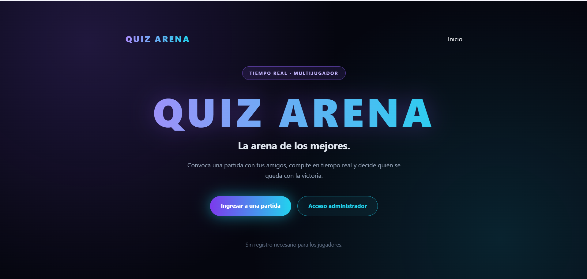

# Quiz ARENA



**Plataforma de desafíos de preguntas con salas y partidas compartidas, desarrollada con Laravel y tecnologías de comunicación en tiempo real.**

## Descripción

**Quiz ARENA** es un proyecto académico desarrollado para la materia Programación de la **Tecnicatura Universitaria en Programación (TUP)**, en la **Universidad Tecnológica Nacional (UTN)**.

La propuesta del trabajo consistió en partir de una implementación de **WebSocket** proporcionada por el profesor y construir, a partir de ella, una aplicación con identidad y funcionalidades propias, utilizando herramientas de inteligencia artificial como apoyo durante el desarrollo.

A partir de esa consigna surgió Quiz ARENA: un sistema de concursos de preguntas que permite organizar salas y partidas a las que los jugadores acceden mediante un código compartido.

## Funcionalidades principales

### Administrador

- Inicio de sesión en el panel de administración.
- Creación, edición y administración de concursos.
- Gestión y ordenamiento de preguntas.
- Creación y administración de salas.
- Inicio y avance de partidas.
- Consulta de partidas y resultados.

### Jugadores

- Ingreso a una partida mediante un código de acceso.
- Participación en desafíos de preguntas.
- Envío de respuestas durante las partidas.
- Consulta del estado de la partida desde la interfaz de participación.

## Tecnologías utilizadas

| Área | Tecnologías |
| --- | --- |
| Backend | PHP 8.3+, Laravel 13 |
| Comunicación en tiempo real | WebSocket, Laravel Reverb, Laravel Echo, Pusher JS |
| Frontend y estilos | JavaScript, Blade, Tailwind CSS |
| Herramientas de desarrollo | Composer, Node.js, npm, Vite |
| Base de datos predeterminada | SQLite |
| Control de versiones | Git y GitHub |

## WebSocket en el proyecto

El punto de partida de la actividad fue un ejemplo de comunicación entre un **emisor** y un **receptor**, en el que el servidor publica un evento y el navegador receptor escucha los cambios en tiempo real.

Quiz ARENA toma esa idea como base y la aplica a un escenario de concursos con administradores, salas, partidas y jugadores. El proyecto incluye Laravel Reverb y Laravel Echo como herramientas para la comunicación por eventos.

Las funcionalidades concretas que se actualizan mediante WebSocket se documentarán con mayor detalle tras completar las pruebas de ejecución del sistema.

## Instalación y ejecución local

### Requisitos

- PHP 8.3 o superior y extensiones requeridas por Laravel.
- Composer.
- Node.js y npm compatibles con la versión de Vite del proyecto.
- SQLite (configuración predeterminada) o una base de datos compatible configurada en Laravel.

### 1. Clonar el repositorio

```bash
git clone https://github.com/RivLaura/Quiz-ARENA.git
cd Quiz-ARENA
```

### 2. Instalar dependencias

```bash
composer install
npm install
```

### 3. Preparar el entorno

Copiar el archivo de ejemplo según el sistema operativo:

**Windows (PowerShell):**

```powershell
Copy-Item .env.example .env
```

**Linux / macOS:**

```bash
cp .env.example .env
```

Generar la clave de la aplicación:

```bash
php artisan key:generate
```

### 4. Configurar la base de datos

La configuración de ejemplo utiliza SQLite. Crear el archivo `database/database.sqlite` si aún no existe y ejecutar:

```bash
php artisan migrate
```

Para generar un usuario administrador **solo para pruebas locales**, el repositorio incluye un seeder:

```bash
php artisan db:seed
```

> **Seguridad:** el seeder crea una cuenta de demostración con credenciales predeterminadas. Utilizarlas únicamente en un entorno local controlado; cambiar o eliminar esas credenciales antes de publicar la aplicación. No ejecutar este seeder en producción.

### 5. Configurar Laravel Reverb

El archivo `.env.example` no viene listo para transmitir eventos con Reverb. Para habilitar WebSocket, hay que instalar/configurar el broadcasting de Laravel Reverb y comprobar que el `.env` contenga la conexión correspondiente:

```dotenv
BROADCAST_CONNECTION=reverb
QUEUE_CONNECTION=sync
```

Se recomienda utilizar el instalador oficial de broadcasting si todavía no están definidos los valores de Reverb:

```bash
php artisan install:broadcasting --reverb
```

Revisar las variables `REVERB_*` y `VITE_REVERB_*` generadas y ajustar host y puertos a la configuración local. No publicar el archivo `.env` ni claves privadas.

> `QUEUE_CONNECTION=sync` simplifica la demostración local. Si se utiliza una cola asíncrona, iniciar también el trabajador de colas con `php artisan queue:work`.

### 6. Iniciar los servicios

Abrir terminales separadas en la carpeta del proyecto:

**Terminal 1 — Aplicación Laravel**

```bash
php artisan serve
```

**Terminal 2 — Compilación del frontend**

```bash
npm run dev
```

**Terminal 3 — Servidor WebSocket**

```bash
php artisan reverb:start
```

Abrir en el navegador:

```text
http://127.0.0.1:8000
```

> Si hay errores de conexión, verificar las variables de entorno, los puertos y la disponibilidad de los servicios. Estos pasos son una guía de configuración local y deben validarse en la máquina donde se ejecutará la demostración.

## Flujo de uso

1. El administrador inicia sesión.
2. Crea un concurso y prepara las preguntas.
3. Crea una sala para organizar la partida.
4. Comparte el código de acceso con los participantes.
5. Los jugadores ingresan usando el código.
6. El administrador inicia la partida y gestiona su avance.
7. Los jugadores envían sus respuestas.
8. Se consultan los resultados de la partida.

## Origen académico y uso de inteligencia artificial

Este proyecto forma parte de una consigna académica que propone **aprovechar una base de conexión WebSocket y personalizar la solución con apoyo de herramientas de IA**.

La idea, la temática de desafíos de preguntas y el enfoque de salas y partidas compartidas corresponden a la propuesta de Quiz ARENA. La inteligencia artificial se utilizó como herramienta de apoyo en el proceso de desarrollo. Este enfoque permitió explorar tecnologías, estructurar funcionalidades y aplicar conocimientos de programación en una aplicación concreta.

## Estado del proyecto

Proyecto académico en desarrollo y revisión para su demostración local. La documentación y la presentación audiovisual se ampliarán después de verificar el recorrido completo de una partida.

## Autora

**Laura — RivLaura**  
Estudiante de la **Tecnicatura Universitaria en Programación (TUP)**.  
**Universidad Tecnológica Nacional (UTN), Facultad Regional Resistencia — Sede Formosa.**

GitHub: [@RivLaura](https://github.com/RivLaura)

---

*Proyecto académico creado con fines de aprendizaje y demostración técnica.*
